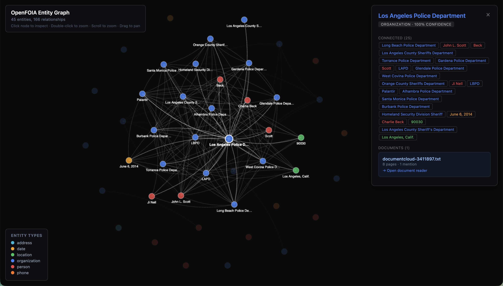
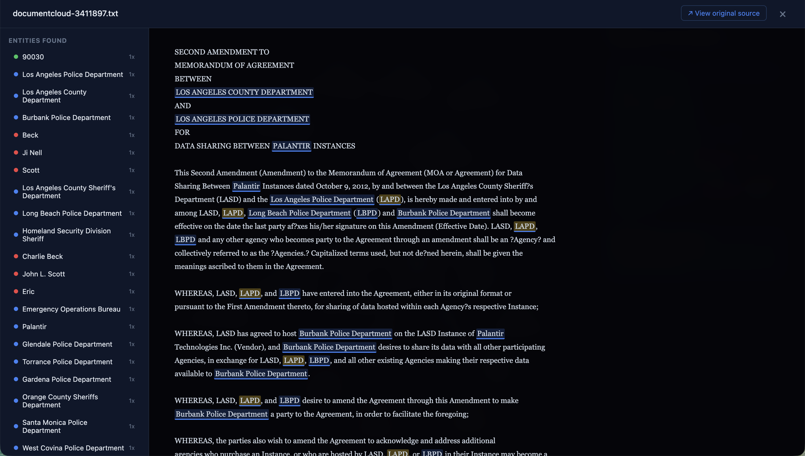

# OpenFOIA

**Local-first investigation toolkit for journalists, researchers, and citizens.**

Anyone, anywhere, should be able to investigate power safely. Most of the world has no legal right to demand records from its government, and where the right exists, asking can be dangerous. OpenFOIA is built for the reporter in Istanbul, the researcher in Nairobi, the citizen in São Paulo: it runs on your machine, works offline, and can be wiped. Your data never leaves your machine unless you choose to send it.

*One real government document, 45 entities, 166 relationships, extracted locally in seconds. No cloud. No API keys.*





---

## Install

### With Claude Code (recommended)

If you use [Claude Code](https://claude.ai/code), install the OpenFOIA plugin. You get the CLI plus a built-in copilot that knows every command:

```
/plugin marketplace add JordanCoin/openfoia
/plugin install openfoia@openfoia
/foia-install
```

The plugin ships a skill that teaches Claude how to run FOIA investigations, plus slash commands for the core loop: `/foia-search`, `/foia-investigate`, `/foia-graph`, `/foia-install`. The last one bootstraps the CLI on your machine.

### Shell install (no Claude Code needed)

```bash
curl -fsSL https://raw.githubusercontent.com/JordanCoin/openfoia/main/install.sh | bash
```

Works on Linux, macOS, and Windows (WSL).

New to OpenFOIA? Run `openfoia guide` after installing.

## What It Does

Find the records. Read them page by page. Record findings with citations. Draft the request to the body that actually holds the record, under the law that body answers to, and track its clock. All locally, all offline, all purgeable.

```bash
openfoia init                                          # 53 federal agencies pre-loaded
openfoia case new "Gifted program, Detroit 1990s"      # one question, one case
openfoia jurisdiction show us-mi                       # the law a Michigan school district answers under
openfoia agency add --name "Detroit Public Schools Community District" -j us-mi -l school_district --email foia.request@detroitk12.org
openfoia records search "Palantir" --source documentcloud --json --rank police,contract   # search 10M+ public documents, ranked
openfoia records fetch --from hits.json                # pull every hit's text, page by page, into the case
openfoia records fetch CIA-RDP96-00789R002200230001-2 --source cia   # CIA reading room PDF, OCR/ingest locally
openfoia docs grep '"school board" OR WISC' -C 120     # every passage, with page numbers, offline
openfoia case note "No document names minors" --doc 3f2a --page 51 --quote "..." --tier says
openfoia analyze graph --name investigation --no-text --view   # graph scoped to the case
openfoia case export -f md -o report.md                # findings with citations, sources, query log
openfoia request mark REQ-2026-001 denied              # starts the appeal clock the statute sets
```

## Features

| | |
|---|---|
| **PDF text extraction** | Compiled 2.6MB binary, zero dependencies. Resolves broken fonts and missing encodings without OCR. Reports each page as text layer, garbled or image only, and only the last two get OCR |
| **Entity extraction** | Four tiers, LLM, GLiNER, spaCy, regex, each falling back to the next. Regex always works, with no model at all |
| **Relationship graphs** | Interactive graph with built-in document reader. Click entities to read source text with highlights |
| **Cross-reference** | MuckRock, DocumentCloud, OpenCorporates, SEC EDGAR, OpenSanctions, ICIJ Offshore Leaks |
| **Claude Code skill** | The plugin teaches Claude the same loop with the same commands, so an agent and a human produce the same cited result |
| **Cases and citations** | One case per question: searches, documents, findings (says / infer / speculation) with document and page, exported as a cited report |
| **Any US jurisdiction** | Federal FOIA plus all 50 states and DC: statute, clock, fees, residency and appeal path per law, sourced from the RCFP Open Government Guide, with a verified flag and sources on every file. Add a school district, city, county or university as a public body under its state law |
| **Request clocks** | Response, extension, tolling, appeal and still-interested deadlines computed from the law that applies, never from a federal default. `deadlines check` tells you what is overdue |
| **File requests** | Email, fax (Twilio), physical mail (Lob) to 53 federal agencies or any body you add |
| **Data interchange** | Import/export FollowTheMoney format (Aleph, OpenAleph, OpenSanctions) |
| **Encrypted storage** | SQLCipher AES-256. Decoy profile mode |
| **Forensic purge** | 3-pass overwrite, shell history scrub, free space fill |
| **Portable mode** | `openfoia portable` keeps everything on the USB, nothing on the host |
| **Metadata stripping** | Strips EXIF, PDF author, DOCX revision history on file and web-UI ingest. Email attachments and archived web pages are stored as received; see [THREAT_MODEL.md](docs/THREAT_MODEL.md) |

### PDF Extraction Engine

A compiled 2.6MB binary extracts text directly from PDF structures, so born-digital documents need no OCR. A multi-level resolution cascade handles broken fonts, missing encodings, and government form PDFs that other tools cannot read.

Measured with engine 0.8.0 on its test corpus of 176 real PDFs (15,808 pages): 13,456 pages (85 percent) extract as a clean text layer. 1,619 are flagged garbled and 733 image only; only those pages go to OCR (Tesseract), and the rest of the document keeps its exact text. Extraction is deterministic: the same file gives the same text on every run. Zero runtime dependencies.

OpenFOIA calls the extractor with the large-document runtime profile by default (`--profile large`).
To control concurrency per process, set:
- `OPENFOIA_PDF_EXTRACT_MAX_WORKERS` (for example `4` or `8`)
- Optional profile override: `OPENFOIA_PDF_EXTRACT_PROFILE=standard|large`

### Reading and searching stored documents

Everything below runs against the local database, with no network access.

```bash
openfoia docs list                                  # stored documents, pages, source
openfoia docs show 3f2a --page 12                   # one page of text (omit --page for all)
openfoia docs grep Hocking                          # every passage that mentions Hocking
openfoia docs grep '"school board" OR WISC' -C 80   # FTS5 phrases, OR, NEAR(a b, 10)
openfoia docs grep audit --doc 3f2a --json          # one document, machine-readable
```

Results cite real page numbers for DocumentCloud documents and ingested PDFs.
Documents stored before page support, or whose page text could not be fetched,
are kept as a single page (`docs show` flags this when the source page count is known). If your SQLite build lacks FTS5
(some SQLCipher builds), `docs grep` does a plain substring search instead and
prints a notice.

Entity extraction picks the best backend it finds. On a local model the LLM
validation step can take minutes per document. To skip it, force a local
backend with `openfoia analyze extract <id> --tier gliner` (or `spacy`,
`regex`), or set `OPENFOIA_AI_PROVIDER=none`, which wins over any API key
or Ollama URL in the config file or environment.

## Which law applies

Federal FOIA reaches only federal executive agencies. A school district, city, county, police department or public university answers under its state's public-records act, with that state's clock, fees and appeal path. OpenFOIA carries one record per law, built from the [RCFP Open Government Guide](https://www.rcfp.org/open-government-guide/), each with its sources and a `verified` flag. Unknown values stay unknown; nothing is invented.

```bash
openfoia jurisdiction list                        # 51 verified, 1 unverified
openfoia jurisdiction show us-tx                  # statute, clock, fees, residency, appeal path, sources
openfoia agency add --name "Austin ISD" -j us-tx -l school_district --custodian-title "Public Information Officer"
openfoia request status REQ-2026-001              # every clock with days left and the rule behind it
openfoia request mark REQ-2026-001 extended       # pushes the due date by the statute's extension
openfoia deadlines check                          # overdue responses, appeals, still-interested replies
```

Which rung of the system holds your record, and how to ask at each, is in [The Records Ladder](docs/RECORDS_LADDER.md).

## Data Sources

`openfoia records search` supports these public-records sources. Each search
sends its query to the selected third party without a confirmation prompt, so
treat queries as sensitive investigation data and run one only when you accept
that disclosure.

| Source | What | Access |
|--------|------|--------|
| [MuckRock](https://www.muckrock.com/) | Completed FOIA requests with downloadable response documents | API token (`OPENFOIA_MUCKROCK_TOKEN`) |
| [DocumentCloud](https://www.documentcloud.org/) | Public documents with pre-extracted text | Public API |
| [CIA FOIA Reading Room](https://www.cia.gov/readingroom/) | Declassified CIA records (CREST, MORI); `records fetch <CREST or MORI> --source cia` downloads and ingests the PDF | Public site; a bot filter can block scripted access, reported as "blocked" |
| [National Archives Catalog](https://catalog.archives.gov/) | Accessioned federal records: descriptions, OCR text where NARA has it, and the scans themselves. `records fetch <NAID> --source nara --objects` downloads every page image or PDF of a record and OCRs it locally; `records search --source nara --ancestor <NAID> --all` lists every file unit in a series | Free key by email (`OPENFOIA_NARA_API_KEY`), 10,000 queries a month, counted locally |
| [OpenCorporates](https://opencorporates.com/) | Global company registrations, ownership, directors, and filings | Free basic search |
| [SEC EDGAR](https://www.sec.gov/edgar/) | US public-company filings | No API key |
| [USAspending](https://www.usaspending.gov/) | Federal contracts, grants, loans, and other awards | No API key |
| [ProPublica Nonprofit Explorer](https://projects.propublica.org/nonprofits/) | IRS Form 990 filings and US nonprofit data | No API key |
| [GovInfo](https://www.govinfo.gov/) | Congressional, court, regulatory, and other US government documents | Free API key; demo key available |
| [OpenFEC](https://api.open.fec.gov/developers/) | Federal campaign-finance contributions and committees | Free API key; demo key available |
| [Regulations.gov](https://www.regulations.gov/) | Federal rulemaking documents and public comments | Free API key; demo key available |
| [OpenSanctions](https://opensanctions.org/) | Sanctions lists and politically exposed persons | Cross-reference source; free non-commercial access |
| [ICIJ Offshore Leaks](https://offshoreleaks.icij.org/) | Panama, Pandora, and Paradise Papers | Cross-reference source; local CSV download |

## Documentation

| Guide | What |
|-------|------|
| **[Journalist Guide](docs/GUIDE.md)** | Full walkthrough. Start here if you're new |
| [The Records Ladder](docs/RECORDS_LADDER.md) | Which rung of the US public-records system holds your record, from the school district to NARA, and how to ask |
| [Tails OS](docs/TAILS.md) | Running from Tails for maximum privacy |
| [USB Install](docs/USB.md) | Encrypted USB portable setup |
| [Air-Gapped](docs/AIRGAP.md) | Offline deployment overview |

## Privacy

Everything runs on `127.0.0.1`. Token-authenticated. Encrypted at rest (optional). Forensically purgeable. Works offline. Open source.

**For sensitive investigations:** `openfoia serve --tor`

**Portable mode:** `openfoia portable` keeps data on the USB; nothing touches the host.

**When you're done:** `openfoia purge --secure --yes`

## Uninstall

```bash
curl -fsSL https://raw.githubusercontent.com/JordanCoin/openfoia/main/uninstall.sh | bash
```

## Legal Context for Contributors

**Writing this code is legal.** The US DOJ stated in August 2025: ["Merely writing code, without ill intent, is not a crime."](https://www.crowdfundinsider.com/2025/08/248043-us-department-of-justice-signals-shift-in-crypto-enforcement-writing-code-is-not-a-crime/) Open source encryption is [exempt from US export controls](https://www.eff.org/deeplinks/2019/08/us-export-controls-and-published-encryption-source-code-explained). The Tor Project, Signal, SecureDrop, and Tails set the precedent. [More context](https://www.linuxfoundation.org/resources/publications/understanding-us-export-controls-with-open-source-projects).

## Credits

Built by people who believe in freedom of information. Inspired by [MuckRock](https://www.muckrock.com/), [DocumentCloud](https://www.documentcloud.org/), and the [Reporters Committee for Freedom of the Press](https://www.rcfp.org/).

## License

AGPL-3.0. Keep it open.

---

*"Democracy dies in darkness. FOIA is how we turn on the lights."*
